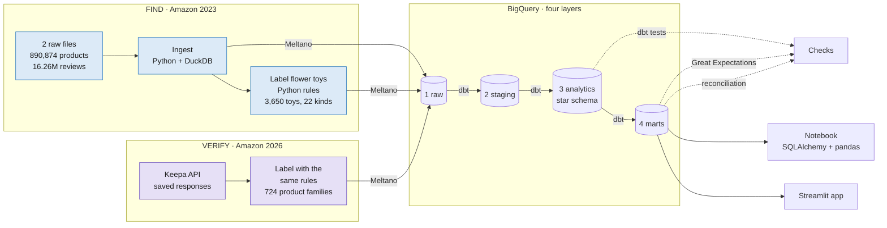
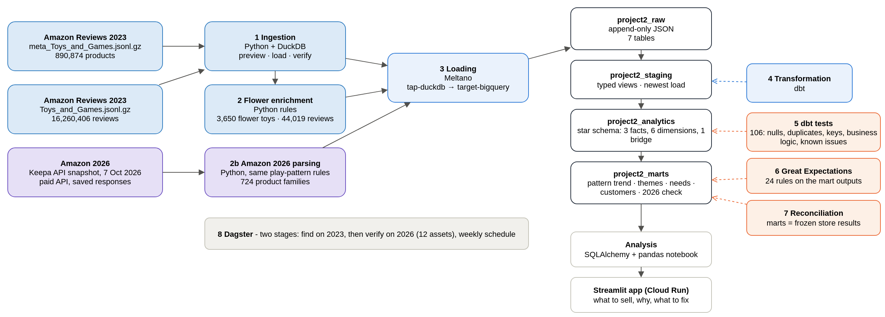
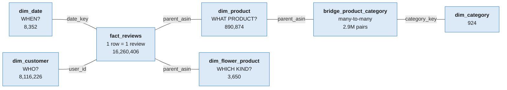
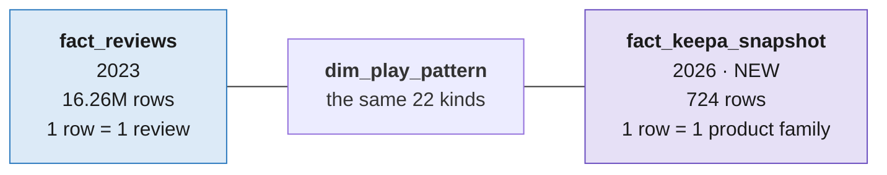

# Project 2: What should my store sell?

I am setting up an online store. Before choosing products I wanted evidence, so this project builds a data pipeline
on Amazon toy reviews. It gives my business a data-driven foundation, and it is one pipeline used twice:

| | FIND · Amazon 2023 | VERIFY · Amazon 2026 |
|---|---|---|
| Question | Which kind of flower toy has the most interest, and what goes wrong with it? | Is that still true on Amazon today? |
| Data | Amazon Reviews 2023, Toys & Games, US: 890,874 products and 16,260,406 reviews | Keepa API snapshot of Amazon.com, 7 Oct 2026: 724 flower-toy product families after filtering and merging variants |
| Source | Free public dataset (McAuley Lab, UCSD), two files, 10 GB | Paid API: 1 h 27 min to fetch, 2,930 API tokens |
| Pipeline | Built here | Reused: 1 step new, 2 the same, 3 with an addition |
| Signal | Written reviews | Rating counts |
| Result | Brick flowers: reviews +76 %, relative growth index 2.76× vs all toys. Other brands received 80 % of those reviews and rate 0.57 points below LEGO. | Top 50 non-LEGO brick flowers: new ratings +194 % (2,124 → 6,255). Ratings unchanged (4.46 → 4.46). |
| Role | Guides the product selection | Supports the choice |

**Answer.** Sell adult brick flowers, and fix what buyers complain about: better quality and easier to build.
Review activity suggests an opportunity. It does not prove sales, so the next step is to check suppliers and test-sell.

**Written report:** [docs/CongruiLIU_Project2_PDF.pdf](docs/CongruiLIU_Project2_PDF.pdf) (the same text as a page: [docs/Project2_Report.md](docs/Project2_Report.md))

**Slides:** [docs/CongruiLIU_Project2_Slides.pdf](docs/CongruiLIU_Project2_Slides.pdf) (executive summary and key findings, 10 pages)

**Live app:** [flower-toy-evidence-839927014785.us-central1.run.app](https://flower-toy-evidence-839927014785.us-central1.run.app) (Streamlit on Cloud Run; it follows the slides and
reads the same marts. The first load takes a few seconds while the service wakes up.)

| | |
|---|---|
| Stack | Python + DuckDB, Meltano, BigQuery, dbt, Great Expectations, Dagster, SQLAlchemy + pandas, Streamlit |
| Warehouse | 4 layers in BigQuery: raw, staging, analytics (star schema), marts |
| Checks | 106 dbt tests (99 pass, 7 warn about known problems in the source), 24 Great Expectations rules, reconciliation of 10 result tables |

### Where each part of the brief is

| Brief | In this repository |
|---|---|
| 1. Data ingestion | `1_ingestion/`, `3_meltano/` |
| 2. Data warehouse design | [Warehouse design](#warehouse-design), `4_dbt/models/analytics/` |
| 3. ELT pipeline, cleaning, derived columns | `4_dbt/models/`, `2_enrichment/` |
| 4. Data quality testing | [Data quality](#data-quality), `4_dbt/tests/`, `5_quality/`, `docs/data_quality_notes.md` |
| 5. Analysis with Python | `8_notebooks/flower_analysis.ipynb` (SQLAlchemy + pandas), `9_streamlit_app/` ([live app](https://flower-toy-evidence-839927014785.us-central1.run.app)) |
| 6. Orchestration | `7_orchestration/definitions.py` (Dagster) |
| 7. Documentation | this file, the report in `docs/CongruiLIU_Project2_PDF.pdf`, the slides in `docs/CongruiLIU_Project2_Slides.pdf`, `docs/architecture.drawio.png` (a picture with the editable draw.io diagram inside), `docs/evidence/` |
| Every step, opened | [Walkthrough](#walkthrough-every-step-opened) below, in full in `8_notebooks/00_pipeline_walkthrough.ipynb` |

## Walkthrough: every step, opened

The DuckDB file (4.7 GB) and the raw files are too big for GitHub, so here is what each step produces, from the last
run (15 Oct 2026). [`8_notebooks/00_pipeline_walkthrough.ipynb`](8_notebooks/00_pipeline_walkthrough.ipynb) opens
each layer itself (DuckDB read-only, BigQuery through SQLAlchemy) and has the columns and sample rows.

**1 · Ingest** (`1_ingestion/`). Two `.jsonl.gz` files into DuckDB, 10 product and 9 review fields.

| DuckDB table | Rows | Empty keys | Duplicate keys |
|---|---:|---:|---:|
| amazon_products_raw | 890,874 | 0 | 0 |
| amazon_reviews_raw | 16,260,406 | 0 | – |

**2 · Label** (`2_enrichment/`). Python rules write three tables back into DuckDB; the 2026 snapshot is parsed with the same rules.

| DuckDB table | Rows | What one row is |
|---|---:|---|
| flower_product_labels | 3,650 | a flower toy with its play pattern (22 kinds) and brand |
| flower_review_themes | 54,752 | a review × a theme it mentions |
| flower_wish_needs | 3,834 | a wish sentence × an unmet need |
| keepa_products | 724 | an Amazon 2026 product family |

**3 · Load** (`3_meltano/`). Meltano copies the tables to `project2_raw`. Raw is append-only, so the small tables hold
one batch per load; staging reads the newest. The newest batch equals DuckDB for all 7 tables, for example
`flower_product_labels`: 5 batches, 18,250 rows, newest batch 3,650.

**4 · Transform** (`4_dbt/`). 7 staging views, then the star schema, then the marts.

| Layer | Models | Largest |
|---|---|---|
| project2_staging | 7 views, 2 seeds | – |
| project2_analytics | 3 facts, 6 dimensions, 1 bridge | fact_reviews 16,260,406 = raw reviews |
| project2_marts | 13 marts | mart_flower_product_stats 3,650 |

Every product and customer key in `fact_reviews` finds its dimension.

**5 · Test** (`4_dbt/tests/`, `5_quality/`). dbt 2023: 106 pass, 7 warn (known problems in the source, e.g. 174,053
duplicate review rows; see `docs/data_quality_notes.md`). dbt 2026: 25 pass. Great Expectations: 15 + 9 rules pass.

**6 · Reconcile** (`6_reconcile/`). The 10 result tables equal `contract/golden/`: `RESULT PASS · contract flower-v1.0-en`.

**7 · Orchestrate** (`7_orchestration/`). Dagster ran steps 1 to 6 for 2023, then for 2026: 12 of 12 PASS in about 4 minutes.


*The Dagster UI on an earlier run of the same job (11 Oct). The record of the 15 Oct run is in `docs/evidence/dagster/run_result.json`.*

**8 · Analyse** (`8_notebooks/flower_analysis.ipynb`). Monthly trend, top products, customer segments and Amazon 2026
on the marts. **9 · App** (`9_streamlit_app/`) shows the same marts online.

## Architecture

Blue is Amazon 2023, purple is Amazon 2026. Everything in BigQuery is shared by both.



Dagster runs all of it in two stages: find on 2023 first, then verify on 2026.
The full architecture, drawn in draw.io:



Editable source: the same file, [`docs/architecture.drawio.png`](docs/architecture.drawio.png). Open it in [app.diagrams.net](https://app.diagrams.net) to edit; the diagram is stored inside the PNG.
The picture above is exported from it.

**The same six steps, for each year**

| Step | 2023 · Find | 2026 · Verify | For 2026 |
|---|---|---|---|
| 1 Ingest | Two files, read by Python + DuckDB | Keepa API, fetched once | new |
| 2 Load | Meltano to BigQuery | Same, with 2 small tables | same |
| 3 Store | Raw layer, never edited | Same raw layer | same |
| 4 Transform | Four layers, star schema, flower rules | Same rules, 1 new fact table | added |
| 5 Test | dbt tests, then Great Expectations | Same kinds, for the new tables | added |
| 6 Dagster | Stage 1 of the run: find | Stage 2, after the 2023 answer | added |

**Where the code is**

| Step | Tool | 2023 | 2026 |
|---|---|---|---|
| Ingest | Python + DuckDB | `1_ingestion/ingest_amazon_to_duckdb.py`: reads the two `.jsonl.gz` files, previews 3 rows, loads 10 + 9 fields, checks counts and keys | `1_ingestion/fetch_keepa_snapshot.py`: reads the saved responses; the API is only called for files that are missing |
| Label | Python | `2_enrichment/build_flower_tables.py`: searches titles for flower words (890,874 → 37,441), keeps the relevant flower toys (→ 3,650), labels them by use (→ 22 play patterns), tags 44,019 reviews with topics | `2_enrichment/build_keepa_tables.py`: keeps flower toys, merges colour and size variants, applies the same play-pattern rules (724 rows) |
| Load | Meltano | `3_meltano/meltano.yml`: `tap-duckdb` and `tap-duckdb-labels-2023` to `target-bigquery` | `tap-duckdb-snapshot-2026` to the same target |
| Transform | dbt | `4_dbt/models/` | the models tagged `amazon_2026` |
| Test | dbt, Great Expectations | `4_dbt/models/**/schema.yml`, `4_dbt/tests/`, `5_quality/gx_validate_flower_marts.py 2023` | the same files, scope `2026` |
| Reconcile | Python | `6_reconcile/`, `contract/`: 5 result tables | 5 more, 10 in total |
| Orchestrate | Dagster | `7_orchestration/definitions.py`, job `find_2023` (6 steps) | job `verify_2026` (6 steps) |
| Analyse | SQLAlchemy + pandas | `8_notebooks/flower_analysis.ipynb` | the same notebook |
| Explore | Streamlit on Cloud Run | `9_streamlit_app/`, deployed from source with `gcloud run deploy`: [live app](https://flower-toy-evidence-839927014785.us-central1.run.app) | the same app, tab 4 |


## Warehouse design

Four datasets, one per layer. I never edit raw; anything that needs fixing is fixed one layer up.

| Layer | What it is for | 2023 · Find | 2026 · Verify |
|---|---|---|---|
| 1 `project2_raw` | Keep the original: one JSON cell per row, exactly as loaded | products, reviews, 3 label tables | 2 small tables: 724 products, 7 groups |
| 2 `project2_staging` | Make it readable: typed columns, no rows dropped | `stg_products`, `stg_reviews`, 3 `stg_flower_*` | `stg_keepa_products`, `stg_keepa_finder_counts` |
| 3 `project2_analytics` | Build the star schema, add the flower-toy type | `fact_reviews`, its dimensions and the bridge; `dim_flower_product`, `dim_play_pattern`, `fact_flower_reviews` | 1 new fact table: `fact_keepa_snapshot` |
| 4 `project2_marts` | Answer the question | 10 marts, e.g. `mart_flower_pattern_trend`, `mart_flower_product_stats`, `mart_flower_theme_evidence` | 3 marts, e.g. `mart_keepa_group_verdict` |

Lineage, for one review of the LEGO Orchid: in raw it is one JSON cell with `"timestamp": 1675286757274`.
Staging unpacks it into typed columns and the number becomes `2023-02-01 21:25`. In `fact_reviews` it is one row
whose `parent_asin` links it to its product. `dim_flower_product` says the Orchid is a brick flower bouquet, and
`mart_flower_pattern_trend` counts it among the 2,002 brick-flower reviews of Jan-Sep 2023.
`dbt docs generate` draws the full graph.

**The star schema (2023)**



One row of the fact is one review. Its keys point to the tables that describe it: when, who, what product, and
which kind of flower toy. Categories hang off the product through a bridge, because the relation is many-to-many.
`fact_flower_reviews` (44,019 rows) is the same fact cut down to flower toys, so the marts are cheap to run.

**What 2026 adds: one fact table**



The 2026 products get their play pattern from the same rules as the 2023 products, and a `relationships` test checks
that every play pattern in the new fact exists in `dim_play_pattern`. That is what lets me compare the two years.

Why I built it this way:

- **Star schema.** Every question I ask is a count or an average over reviews, grouped by product, customer or month.
  One fact table at review grain with dimensions around it keeps those queries simple and avoids double counting.
- **Partitioning and clustering.** `fact_reviews` is partitioned by review year and clustered by `parent_asin` and
  `user_id`, because almost everything groups by product or by customer. Queries then read a fraction of the 6 GB table.
- **Bridge table.** Products and categories are many-to-many. The Orchid has 2 categories and 522 reviews; joined
  straight to its categories it becomes 2 rows and 1,044 reviews. The bridge stores the pairs separately, so the
  product stays one row. Category joins still have to be aggregated with care.
- **Customer dimension.** The dataset has reviews, not orders, so `dim_customer` describes review behaviour
  (how many, over how long).
- **A separate flower dimension and a small flower fact.** The flower labels come from my own rules and will change
  more often than the catalogue, so they live in `dim_flower_product`. `fact_flower_reviews` has only 44,019 rows, so
  the marts and the notebook cost almost nothing to run.
- **Time zone as a setting.** Months and years are cut in `Asia/Singapore`, set in `dbt_project.yml`. I added this
  after my laptop and BigQuery disagreed on monthly counts.

Derived columns include `play_pattern` (from the flower rules), `relative_growth_index` (the change in a play pattern's
reviews divided by the change in all toy reviews: 1.76 ÷ 0.64 = 2.76 for brick flowers; 1.00 means the same as the
market), `low_rating_pct`, `evidence_level`, `quadrant`, `lifetime_review_count`, `activity_segment` and
`is_duplicate_review`.

## Why these tools

| I chose | Over | Because |
|---|---|---|
| DuckDB for the local load | Supabase (Postgres) | The free tier stops at 500 MB and I have 10 GB. DuckDB processes it on my laptop, reads `.jsonl.gz` directly and needs no server. |
| Meltano | My own upload script | A tap and a target are configuration, not code, and loading a new table is one more line. |
| BigQuery | Staying in DuckDB | Others can query it, it handles the full review table in seconds, and partitioning is declared, not managed. |
| dbt | Running SQL files by hand | Models run in dependency order and tests live next to the model. |
| A Python step for labelling | SQL in dbt | My rules use regex look-aheads and sentence splitting. BigQuery's regex engine does not support look-aheads. |
| Great Expectations on top of dbt tests | Only dbt tests | dbt tests check data model integrity on every model. Great Expectations checks the data quality of the mart outputs and gives a readable report. |
| Dagster | Cron | Steps know what they depend on, a failure stops the rest, and each run records what happened. |

One thing I had to work around: the BigQuery target cannot overwrite a partitioned table, so I keep raw append-only
and let staging pick the newest load (`macros/latest_load.sql`).

## Data quality

Four checks along the pipeline, each on a different part, and a reconciliation at the end.

| Where | Tool | What it checks |
|---|---|---|
| At ingest | DuckDB | The keys of the two raw files: 0 empty, 0 duplicate product keys. |
| At load | Meltano | Rows before the load equal rows after: 890,874 in DuckDB, 890,874 in BigQuery. |
| At transform | dbt tests (106) | Data model integrity: is every table built right? |
| At the end | Great Expectations (24) | Data quality: does the answer make sense? Mart outputs: 3 tables in 2023, 2 in 2026. |
| After that | Reconciliation (10 tables) | The decision metrics equal the results my store uses: 5 tables for 2023, 5 more for 2026. |

**dbt tests: 106 = 99 pass, 7 warn, 0 errors** (2023: 87 tests · 2026: 19 tests)

| Kind | Tests | What it covers |
|---|---|---|
| Null values (`not_null`) | 41 | No empty key: every review has a product, a date and a customer. |
| Duplicates (`unique`) | 20 | Keys are unique at each table's grain: one row per product, per date, per customer. |
| Referential integrity (`relationships`) | 12 | Each key in a fact table is found in its dimension. |
| Business logic | 26 | Value rules and row counts: ratings 1 to 5, positive prices, row counts preserved. 19 value rules and 7 tests in my own SQL. |
| Known source issues (warn, do not fail) | 7 | Source issues are kept and flagged, e.g. 174,053 duplicate reviews: index 2.76× with them, 2.77× without. |

**Great Expectations: 24 rules, 24 pass** (2023: 15 rules · 2026: 9 rules)

| Kind | Rules | Example |
|---|---|---|
| Complete | 3 | All 22 kinds of flower toy have a row. |
| Possible | 13 | Each kind's average rating is between 1 and 5. This checks the output range, not the formula. |
| Allowed | 4 | A label comes from a fixed list: a verdict is trending, stable or not trending. |
| Consistent | 4 | Topic mentions never exceed the reviews of a pattern (one review may mention several topics). |

Not everything is clean, and I did not want a wall of green ticks hiding that. The source has 174,053 duplicate
review rows, 25,394 reviews without text and about 5,260 products whose metadata rating is more than a star away from
their own reviews. These are reported on every build and become errors past a limit. Duplicates are flagged, not
deleted, and I checked that they do not change the result (index 2.76× with them, 2.77× without).
Details and the failures I ran into are in [`docs/data_quality_notes.md`](docs/data_quality_notes.md).

## What I found

The notebook has the tables and charts. The [Streamlit app](https://flower-toy-evidence-839927014785.us-central1.run.app) shows the same marts and follows the slides:
which kind, what goes wrong, my plan, Amazon 2026.

### 2023 · Find

**Which kind?** Brick flowers lead in review activity, and the demand extends beyond LEGO.

| Kind of flower toy | Reviews 2022 | Reviews 2023 | Change | vs all toys |
|---|---|---|---|---|
| **Brick flower bouquets** | 1,135 | 2,002 | 1.76× | **2.76×** |
| Toddler garden sets | 1,235 | 795 | 0.64× | 1.01× |
| Craft bouquets | 305 | 174 | 0.57× | 0.89× |
| Flower-image puzzles | 1,803 | 892 | 0.49× | 0.77× |
| Planting kits | 149 | 57 | 0.38× | 0.60× |
| All toys (the market) | 1.42M | 0.90M | 0.64× | 1.00× |

Reviews written Jan-Sep. vs all toys = change ÷ 0.64, so 1.00 means the same as the market.

**Who gets the growth?**

| | Reviews 2022 → 2023 | Change | Share of reviews | Rating |
|---|---|---|---|---|
| LEGO | 427 → 405 | -5 % | 38 % → 20 % | 4.72 |
| Other brands | 708 → 1,597 | +126 % | 62 % → 80 % | 4.15 |

**What goes wrong?** Of the 521 brick-flower reviews rated 1 or 2 stars (one review can mention several topics):

| Complaint | Share | Brands | My plan |
|---|---|---|---|
| Missing pieces | 30 % | 111 | Checked counts, numbered bags |
| Falls apart or droops | 17 % | 96 | Sturdy stems |
| Too hard, needed help | 12 % | 87 | Clear instructions |

So: sell adult brick flowers, with better quality and easier to build. The reviews point to improvement
opportunities; supplier checks have to verify them.

### 2026 · Verify

- **The sample.** 724 flower-toy product families after filtering and merging variants, from three lists:
  335 top sellers today + 308 new since 2024 + 81 top products of 2023. The two questions below use the selected
  top 50 non-LEGO brick-flower products.
- **Is rating activity still growing?** Yes. New ratings between 1 Jan and 7 Oct: 2,124 in 2025, 6,255 in 2026
  (+194 %). Almost three times as many.
- **Have ratings improved?** No change. For 26 matched products the mean was 4.46 stars a year ago and 4.46 now.
  This is a separate snapshot check, outside the pipeline.
- **So:** more rating activity, ratings unchanged. The evidence supports the direction: sell brick flowers and test
  quality improvements.

### Limits

Reviews and ratings are not sales. 2023 uses written reviews and 2026 uses rating counts, and the selected 2026
sample is not the same product cohort as 2023. Keepa also returns Amazon's "bought in past month" badge; it is
rounded and missing for many products, so I keep it in the marts but do not base a conclusion on it. It is one US
marketplace. The review data ends in September 2023 and thins out after March 2023, which is why I compare with the
whole toy market instead of reading the counts raw. My labels are rules that I checked on samples (12 to 15 right
out of 15 per main play pattern), not a trained model.

## Running it

Meltano, dbt and Great Expectations need different package versions, so each has its own virtual environment
(`requirements/`). Log in with `gcloud auth application-default login`, copy `4_dbt/profiles.example.yml` to
`~/.dbt/profiles.yml`, and set `PROJECT2_RAW_DIR` to the folder with the two raw files.

```bash
# ---- 2023 · Find ----
python 1_ingestion/ingest_amazon_to_duckdb.py          # add --rebuild to load from the raw files again
python 2_enrichment/build_flower_tables.py
cd 3_meltano && meltano install
meltano run tap-duckdb target-bigquery               # first time only: everything, including 16M reviews
meltano run tap-duckdb-labels-2023 target-bigquery   # afterwards: the flower labels
cd ../4_dbt && dbt build --full-refresh --exclude tag:amazon_2026+
cd .. && python 5_quality/gx_validate_flower_marts.py 2023

# ---- 2026 · Verify ----
python 1_ingestion/fetch_keepa_snapshot.py             # uses the cache; needs KEEPA_API_KEY only for missing files
python 2_enrichment/build_keepa_tables.py
cd 3_meltano && meltano run tap-duckdb-snapshot-2026 target-bigquery
cd ../4_dbt && dbt build --select tag:amazon_2026+
cd .. && python 5_quality/gx_validate_flower_marts.py 2026

# ---- both: compare with the frozen results ----
python 6_reconcile/export_marts_for_contract.py
python 6_reconcile/verify_against_contract.py docs/evidence/contract/export
```

Or run everything except the first big load with Dagster: `cd 7_orchestration && python run_once.py`
(`dagster dev -f definitions.py` for the UI and the schedule). Dagster reads the command for each tool from
`PROJECT2_PYTHON`, `PROJECT2_PYTHON_QUALITY`, `PROJECT2_MELTANO` and `PROJECT2_DBT`.

The run has two stages, in the order I did the work:

| Stage | Steps | Ends with |
|---|---|---|
| FIND · Amazon 2023 | 1 check the raw tables, 2 label the flower toys, 3 load the labels, 4 dbt: build and test, 5 Great Expectations, 6 reconcile the decision metrics | 5 tables match |
| VERIFY · Amazon 2026 | 7 read the saved snapshot, 8 label the products, 9 load the snapshot, 10 dbt: build and test, 11 Great Expectations, 12 reconcile the decision metrics | all 10 tables match |

The 2023 checks pass before the 2026 stage reads the saved snapshot, because the snapshot is taken for the product
groups that the 2023 answer points to. If one step fails, the steps after it do not run. In dbt the 2026 models carry the
tag `amazon_2026`, so the first build uses `--exclude tag:amazon_2026+` and the second `--select tag:amazon_2026+`.
Each stage is also a job of its own (`find_2023`, `verify_2026`).

What the recorded run is, and is not. The last run passed 12 of 12 steps in about 4 minutes
(`docs/evidence/dagster/run_result.json`, screenshots in `docs/screenshots/`). That is a re-run: the 16 million reviews were
already in BigQuery and the Keepa responses were already saved, so the run checks the raw tables and reads the
snapshot from disk. The first load of the reviews and the API collection (1 h 27 min, 2,930 tokens) were done once,
separately. The weekly schedule (Mondays 06:00, Asia/Singapore) is defined in `definitions.py` and fires when the
Dagster daemon is running; I started the recorded run by hand.

## Scaling it

- **More data.** `fact_reviews` is partitioned by year and clustered by product and customer, raw is append-only, and
  the marts read the small flower fact (44,019 rows) instead of the 16 million.
- **A second source.** Amazon 2026 came in through the same pipeline: one new ingest step, the same load and raw
  layer, one new fact table, the same kinds of tests, a second stage in Dagster.
- **Another category.** Toys today, other categories next. The orchestration structure can be reused with
  category-specific inputs, labels and validation rules. Another category still needs its own data, label checks
  and business-rule settings; that part is not automatic.

## Folders

```
1_ingestion/       raw files and Keepa API into DuckDB
2_enrichment/      flower rules, review codebook, Keepa parsing
3_meltano/         DuckDB to BigQuery: tap and target configuration
4_dbt/             models, seeds, macros, tests
5_quality/         Great Expectations
6_reconcile/       export the marts and compare them with the contract
7_orchestration/   Dagster
8_notebooks/       00_pipeline_walkthrough (every step, opened) and flower_analysis
9_streamlit_app/   app that shows the marts, with the Dockerfile used for Cloud Run
contract/          the frozen results (see contract/README.md)
docs/              written report, diagram, data quality notes, screenshots, run evidence
requirements/      one file per virtual environment
```

Raw data, the DuckDB file, the Keepa cache, virtual environments and credentials are not in the repository.
