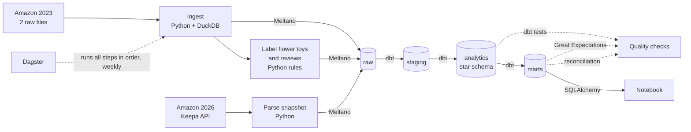
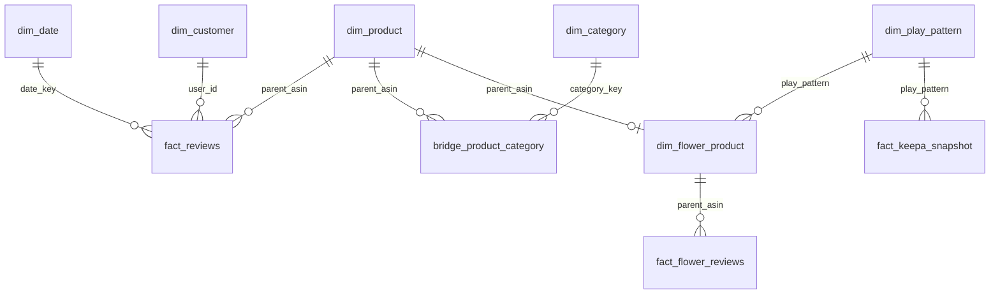

# Project 2: which flower toy should a gift store sell?

I am setting up an online gift store around flowers. Before choosing products I wanted evidence, so this project
builds a data pipeline on Amazon toy reviews and uses it to answer two questions:

1. **Find (Amazon 2023):** which kind of flower toy do people want, and what do they complain about?
2. **Verify (Amazon 2026):** is that still true on Amazon today?

**Short answer.** Adult brick flower bouquets. In the 2023 data they grew 2.76 times faster than the toy market, and
in 2026 they are still the group with the most new products selling. Buyers like how they look but complain about
missing pieces, builds that fall apart and unclear instructions. That list is what my store has to do better.

| | |
|---|---|
| Data | Amazon Reviews 2023, Toys & Games: 890,874 products and 16,260,406 reviews. Keepa API snapshot of 7 Oct 2026: 1,198 products. |
| Stack | Python + DuckDB, Meltano, BigQuery, dbt, Great Expectations, Dagster, SQLAlchemy + pandas |
| Warehouse | 4 layers in BigQuery: raw, staging, analytics (star schema), marts |
| Checks | 106 dbt tests (7 of them report known problems in the source), 24 Great Expectations rules, reconciliation with the results my store was built on |

## Architecture



The same diagram, editable, is in [`docs/architecture.drawio`](docs/architecture.drawio).

| Step | Tool | Where | What it does |
|---|---|---|---|
| Ingest | Python + DuckDB | `ingestion/ingest_amazon_to_duckdb.py` | Reads the two `.jsonl.gz` files into DuckDB. Previews 3 rows, loads 10 + 9 fields, checks counts and keys. |
| Label | Python | `enrichment/build_flower_tables.py` | Finds flower toys (3,650), gives each a play pattern, tags 44,019 reviews with themes, pulls out "I wish it had..." sentences. |
| Amazon 2026 | Python + Keepa API | `ingestion/fetch_keepa_snapshot.py`, `enrichment/build_keepa_tables.py` | Fetches (or reads from cache) the Keepa snapshot and applies the same play-pattern rules. |
| Load | Meltano | `meltano/meltano.yml` | `tap-duckdb` to `target-bigquery`. Raw tables are append-only. |
| Transform | dbt | `project2_dbt/models/` | Staging views, star schema, marts. |
| Test | dbt | `project2_dbt/models/**/schema.yml`, `project2_dbt/tests/` | Nulls, duplicates, foreign keys, business rules. |
| Business rules | Great Expectations | `quality/gx_validate_flower_marts.py` | Checks the final tables a business reader would use. |
| Reconcile | Python | `scripts/`, `contract/` | Compares the marts with the frozen results the store was built on. |
| Orchestrate | Dagster | `orchestration/definitions.py` | 7 assets in dependency order, weekly schedule. |
| Analyse | SQLAlchemy + pandas | `notebooks/flower_analysis.ipynb` | Monthly trend, top products, customer segments, 2026 check. |

## Warehouse design

Four datasets. I never edit raw; anything that needs fixing is fixed one layer up.

| Dataset | What is in it |
|---|---|
| `project2_raw` | What Meltano loaded: one JSON record per row. |
| `project2_staging` | Views that unpack the JSON into typed columns. No rows are dropped. |
| `project2_analytics` | The star schema. |
| `project2_marts` | One table per question. |



| Table | One row is | Rows |
|---|---|---|
| `fact_reviews` | a customer review | 16,260,406 |
| `dim_product` | a product (parent ASIN) | 890,874 |
| `dim_customer` | a reviewer | 8,116,226 |
| `dim_date` | a calendar date | 8,352 |
| `dim_category`, `bridge_product_category` | a category; a product-category pair | 924; 2.9M |
| `dim_play_pattern` | a way of playing with a flower toy | 22 |
| `dim_flower_product` | a flower toy | 3,650 |
| `fact_flower_reviews` | a review of a flower toy | 44,019 |
| `fact_keepa_snapshot` | a product family on Amazon on 7 Oct 2026 | 724 |

Why I built it this way:

- **Star schema.** Every question I ask is a count or an average over reviews, grouped by product, customer or month.
  One fact table at review grain with dimensions around it keeps those queries simple and avoids double counting.
- **Partitioning and clustering.** `fact_reviews` is partitioned by review year and clustered by `parent_asin` and
  `user_id`, because almost everything groups by product or by customer. Queries then read a fraction of the 6 GB table.
- **Bridge table.** A product has several categories and a category has many products. Putting categories in a bridge
  means I can count by category without multiplying reviews.
- **Customer dimension.** The dataset has reviews, not orders, so `dim_customer` describes review behaviour
  (how many, over how long). That is what the customer segmentation uses.
- **A separate flower dimension and a small flower fact.** The flower labels come from my own rules and will change
  more often than the catalogue, so they live in `dim_flower_product`. `fact_flower_reviews` has only 44,019 rows, so
  the marts and the notebook cost almost nothing to run.
- **Time zone as a setting.** Months and years are cut in `Asia/Singapore`, set in `dbt_project.yml`. I added this
  after my laptop and BigQuery disagreed on monthly counts.

Derived columns include `relative_growth_index` (growth of a play pattern divided by growth of the whole toy market),
`low_rating_pct`, `evidence_level`, `quadrant`, `lifetime_review_count`, `activity_segment` and `is_duplicate_review`.

## Why these tools

| I chose | Over | Because |
|---|---|---|
| DuckDB for the local load | Supabase (Postgres) | The free tier stops at 500 MB and I have 16 million reviews. DuckDB reads `.jsonl.gz` directly and needs no server. |
| Meltano | My own upload script | A tap and a target are configuration, not code, and loading a new table is one more line. |
| BigQuery | Staying in DuckDB | Others can query it, it handles the full review table in seconds, and partitioning is declared, not managed. |
| dbt | Running SQL files by hand | Models run in dependency order and tests live next to the model. |
| A Python step for labelling | SQL in dbt | My rules use regex look-aheads and sentence splitting. BigQuery's regex engine does not support look-aheads. |
| Great Expectations on top of dbt tests | Only dbt tests | dbt tests check structure on every model. Great Expectations checks the few final tables in business terms and gives a readable report. |
| Dagster | Cron | Steps know what they depend on, a failure stops the rest, and each run records what happened. |

One thing I had to work around: the BigQuery target cannot overwrite a partitioned table, so I keep raw append-only
and let staging pick the newest load (`macros/latest_load.sql`).

## Data quality

| Check | Count | What it covers |
|---|---|---|
| dbt `not_null` | 41 | keys, ratings, labels |
| dbt `unique` | 20 | one row per product, date, customer, category, play pattern, group |
| dbt `relationships` | 12 | every review has a product, a date and a customer |
| dbt value rules | 19 | rating 1 to 5, price above 0, shares 0 to 100, labels from a fixed list |
| dbt business-logic tests | 7 | warehouse rows equal raw rows; totals by play pattern equal the fact table |
| dbt known-issue tests | 7 | real problems in the source, reported as warnings with a count |
| Great Expectations | 24 | plausibility of the final tables |
| Reconciliation | 10 tables | the marts equal the results my store uses |

Not everything is clean, and I did not want a wall of green ticks hiding that. The source has 174,053 duplicate
review rows, 25,394 reviews without text and about 5,260 products whose metadata rating is more than a star away from
their own reviews. These are reported on every build and become errors past a limit. Duplicates are flagged, not
deleted, and I checked that they do not change the result (growth 2.76 with them, 2.77 without).
Details and the failures I ran into are in [`docs/data_quality_notes.md`](docs/data_quality_notes.md).

## What I found

The notebook has the tables and charts. In short:

**2023**
- Brick flower bouquets: 350 products from 226 brands. Reviews in Jan-Sep went from 1,135 to 2,002 while the whole
  toy dataset dropped 36 %. No other large flower pattern beat the market.
- Reviews peak around December and January. These are gifts.
- Two LEGO sets top the list, but most of the growth is other brands, which rate 4.15 against LEGO's 4.72.
- 97 % of flower-toy customers buy once. The few who come back rate higher.
- People buy them as gifts (20 % of reviews) and as decor (13 %).
- In 1-2 star reviews, 30 % mention missing pieces (111 brands) and 17 % say the build falls apart (96 brands).
  Buyers ask for clearer instructions, a vase, sturdier stems and numbered bags.
- DIY in general is not the trend. Crafts, toddler stacking sets and planting kits did not beat the market.

**2026**
- Non-LEGO brick flowers are still trending: ratings added in 2026 are nearly three times those of 2025 and 65 new
  products since 2024 already sell 50+ a month.
- Planting kits and toddler garden sets are not trending. Flower crafts were behind in 2023 and are trending now.
- New since 2024: gothic brick flowers, single-stem series, fabric bouquet kits for kids, no-glue bouquet kits.
- The top products of 2023 mostly faded. Growth comes from new products, so a store has to keep refreshing its range.

Limits: review and rating counts stand in for sales. It is one US marketplace. The review data ends in September 2023
and thins out after March 2023, which is why I compare growth with the whole toy market instead of reading it raw.
My labels are rules that I checked on samples (12 to 15 right out of 15 per main play pattern), not a trained model.

## Running it

Meltano, dbt and Great Expectations need different package versions, so each has its own virtual environment
(`requirements/`). Log in with `gcloud auth application-default login`, copy `project2_dbt/profiles.example.yml` to
`~/.dbt/profiles.yml`, and set `PROJECT2_RAW_DIR` to the folder with the two raw files.

```bash
python ingestion/ingest_amazon_to_duckdb.py          # add --rebuild to load from the raw files again
python enrichment/build_flower_tables.py
python ingestion/fetch_keepa_snapshot.py             # uses the cache; needs KEEPA_API_KEY only for missing files
python enrichment/build_keepa_tables.py

cd meltano && meltano install
meltano run tap-duckdb target-bigquery               # first time: everything, including 16M reviews
meltano run tap-duckdb-refresh target-bigquery       # afterwards: only the small tables

cd ../project2_dbt && dbt build --full-refresh
cd .. && python quality/gx_validate_flower_marts.py
python scripts/export_marts_for_contract.py
python scripts/verify_against_contract.py docs/evidence/contract/export
```

Or run everything except the first big load with Dagster: `cd orchestration && python run_once.py`
(`dagster dev -f definitions.py` for the UI and the weekly schedule). Dagster reads the command for each tool from
`PROJECT2_PYTHON`, `PROJECT2_PYTHON_QUALITY`, `PROJECT2_MELTANO` and `PROJECT2_DBT`. A full run takes about 4 minutes;
the last one is recorded in `docs/evidence/dagster/run_result.json`.

## Folders

```
ingestion/      raw files and Keepa API into DuckDB
enrichment/     flower rules, review codebook, Keepa parsing
meltano/        tap and target configuration
project2_dbt/   models, seeds, macros, tests
quality/        Great Expectations
scripts/        export marts and compare with the contract
contract/       the frozen results (see contract/README.md)
orchestration/  Dagster
notebooks/      analysis
docs/           diagram, data quality notes, run evidence
```

Raw data, the DuckDB file, the Keepa cache, virtual environments and credentials are not in the repository.
