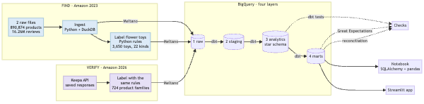
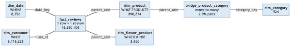
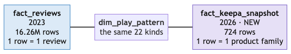
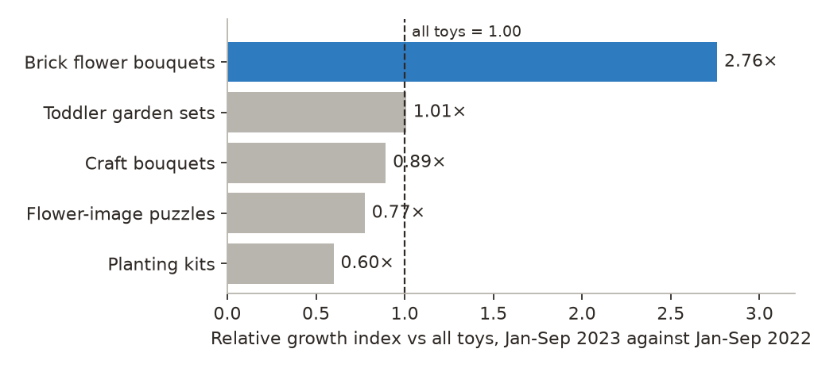
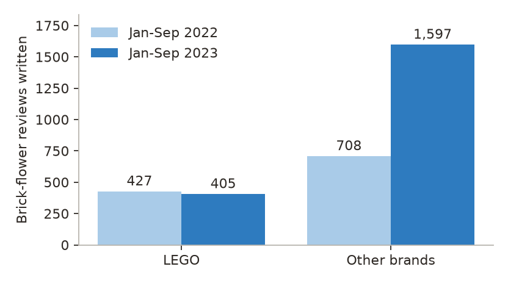
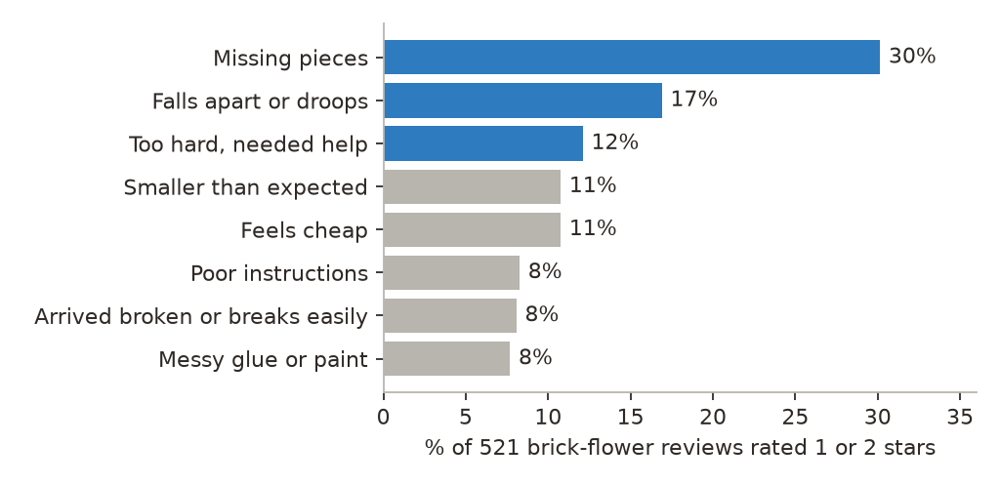
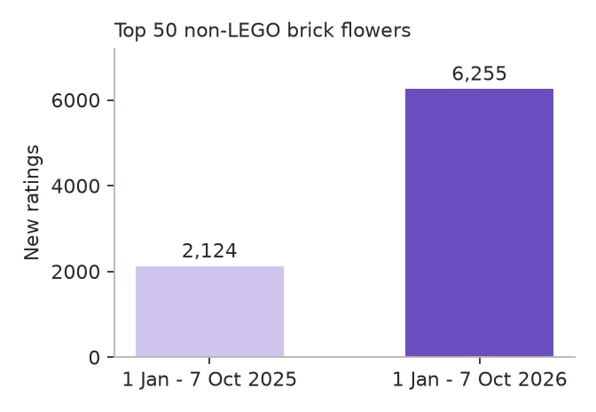
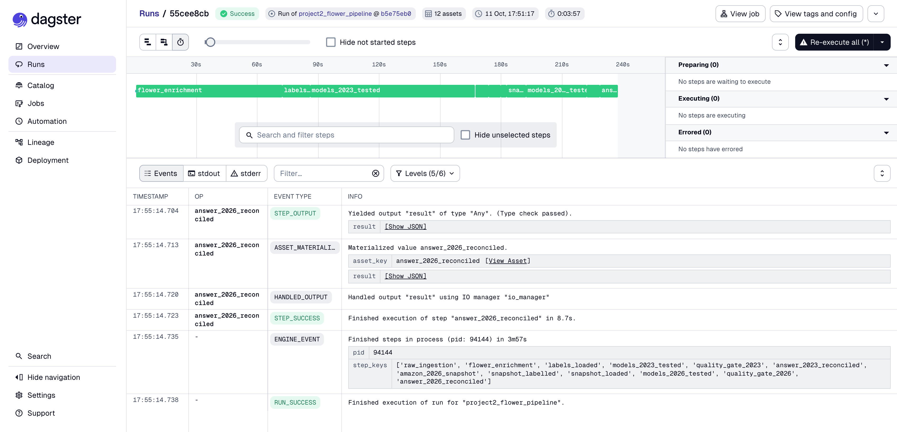

# What should my store sell?

**Module 2 Assignment Project: written report**
Congrui LIU (Rachelle), Group 6 · 13 October 2026

Code and documentation: this repository. Live app: https://flower-toy-evidence-839927014785.us-central1.run.app

## 1. Summary

I am setting up an online store and wanted evidence before choosing products. This project is a data pipeline on
Amazon toy reviews that answers one question twice.

| | FIND · Amazon 2023 | VERIFY · Amazon 2026 |
|---|---|---|
| Question | Which kind of flower toy has the most interest, and what goes wrong with it? | Is that still true on Amazon today? |
| Data | 890,874 products and 16,260,406 reviews (Amazon Reviews 2023, Toys & Games, US) | 724 flower-toy product families (Keepa API snapshot, 7 Oct 2026) |
| Result | Brick flowers: reviews +76 %, relative growth index 2.76× vs all toys. Other brands received 80 % of those reviews and rate 0.57 points below LEGO. | Top 50 non-LEGO brick flowers: new ratings +194 %. Ratings unchanged. |

**Answer.** Sell adult brick flowers, and fix what buyers complain about: better quality and easier to build.
Review activity suggests an opportunity. It does not prove sales, so the next step is to check suppliers and test-sell.

The pipeline is Python + DuckDB, Meltano, BigQuery, dbt, Great Expectations and Dagster. It was built for the 2023
data and reused for the 2026 data: one step was new, two stayed the same and three got an addition.

## 2. Technical approach

*Figure 1. The pipeline. Blue is Amazon 2023, purple is Amazon 2026. BigQuery is shared by both.*

**Ingest.** The source is two `.jsonl.gz` files, 10 GB together. A Python script reads them into DuckDB on my
laptop. It previews three rows first, loads 10 product fields and 9 review fields, and then checks the result:
890,874 products and 16,260,406 reviews, no empty keys and no duplicate product keys.

**Label.** The dataset has no "flower toy" category, so a Python step finds them in three passes: search titles for
flower words (890,874 → 37,441 products), keep the relevant flower toys (→ 3,650), and label each by how it is used
(→ 22 play patterns, such as brick bouquets, planting kits, plush and puzzles). The same step tags the 44,019
reviews of these toys with topics such as "missing pieces".

**Load and store.** Meltano moves the tables from DuckDB to BigQuery (`tap-duckdb` to `target-bigquery`). Each row
arrives as one JSON cell in the raw layer and is never edited there. The row count is the same before and after:
890,874 in DuckDB, 890,874 in BigQuery.

**Transform.** dbt builds three layers on top of raw. One review of the LEGO Orchid shows what each layer does:

| Layer | What it is for | The same review |
|---|---|---|
| 1 Raw | Keep the original | one JSON cell: `{"parent_asin": "B09Q4L157D", "rating": 5, "timestamp": 1675286757274, ...}` |
| 2 Staging | Make it readable | typed columns; the number is now a time: `2023-02-01 21:25` |
| 3 Analytics | Build the star schema, add the flower-toy type | one row in `fact_reviews`; its `parent_asin` links it to the product, and `dim_flower_product` says "brick flower bouquets" |
| 4 Marts | Answer the question | counted among the 2,002 brick-flower reviews of Jan-Sep 2023 |

**Test.** dbt tests check the model, then Great Expectations checks the outputs (section 4).

**Orchestrate.** Dagster runs everything in two stages (section 7).

**Analyse.** A notebook reads the marts with SQLAlchemy and pandas. A Streamlit app on Cloud Run shows the same
marts in a browser.

### Why these tools

| I chose | Over | Because |
|---|---|---|
| DuckDB for the local load | Supabase (Postgres) | The free tier stops at 500 MB and I have 10 GB. DuckDB processes it on my laptop, reads `.jsonl.gz` directly and needs no server. |
| Meltano | My own upload script | A tap and a target are configuration, not code. Loading the 2026 tables was one more block in the same file. |
| BigQuery | Staying in DuckDB | Others can query it, it handles the full review table in seconds, and partitioning is declared, not managed. |
| dbt | Running SQL files by hand | Models run in dependency order and tests live next to the model. |
| A Python step for labelling | SQL in dbt | The rules use regex look-aheads and sentence splitting. BigQuery's regex engine does not support look-aheads. |
| Great Expectations on top of dbt tests | Only dbt tests | dbt tests check data model integrity on every model. Great Expectations checks the data quality of the mart outputs and gives a readable report. |
| Dagster | Cron | Steps know what they depend on, a failure stops the rest, and each run records what happened. |

## 3. Warehouse design

*Figure 2. The star schema for 2023. One row of the fact is one review.*

The keys of `fact_reviews` point to the tables that describe a review: when (`dim_date`), who (`dim_customer`),
what product (`dim_product`) and which kind of flower toy (`dim_flower_product`).

Why this design, and how it supports efficient querying:

- **A star at review grain.** Every question I ask is a count or an average over reviews, grouped by product,
  customer or month. One fact table with dimensions around it keeps those queries to one join per dimension and
  avoids double counting.
- **Partitioning and clustering.** `fact_reviews` is partitioned by review year and clustered by `parent_asin` and
  `user_id`, because almost everything filters by year and groups by product or customer. A query reads a fraction of
  the 6 GB table.
- **A bridge for categories.** Products and categories are many-to-many. The Orchid has 2 categories and 522 reviews;
  joined straight to its categories it becomes 2 rows and 1,044 reviews, which is wrong. The bridge stores the pairs
  separately, so the product stays one row. Category joins still need careful aggregation.
- **A separate flower dimension and a small flower fact.** The flower labels come from my own rules and will change
  more often than the catalogue, so they live in `dim_flower_product`. `fact_flower_reviews` has 44,019 rows, so
  the marts cost almost nothing to run.

*Figure 3. What 2026 adds: one fact table, linked through the same 22 play patterns.*

The 2026 products get their play pattern from the same rules as the 2023 products. That is what lets me compare the
two years.

Derived columns include `play_pattern`, `relative_growth_index`, `low_rating_pct`, `evidence_level`,
`lifetime_review_count` and `is_duplicate_review`. The relative growth index is the change in a play pattern's
reviews divided by the change in all toy reviews. For brick flowers that is 1.76 ÷ 0.64 = 2.76. I use it because the
dataset thins out in 2023 for every category, so a raw year-on-year number would mislead.

## 4. Data quality

Four checks along the pipeline, each on a different part, and a reconciliation at the end.

| Where | Tool | What it checks |
|---|---|---|
| At ingest | DuckDB | The keys of the two raw files: 0 empty, 0 duplicate product keys. |
| At load | Meltano | Rows before the load equal rows after. |
| At transform | dbt tests (106) | Data model integrity: is every table built right? |
| At the end | Great Expectations (24) | Data quality: does the answer make sense? |
| After that | Reconciliation (10 tables) | The decision metrics equal the results my store uses. |

**dbt tests: 106 = 99 pass, 7 warn, 0 errors** (2023: 87 tests · 2026: 19 tests)

| Kind | Tests | What it covers |
|---|---|---|
| Null values (`not_null`) | 41 | No empty key: every review has a product, a date and a customer. |
| Duplicates (`unique`) | 20 | Keys are unique at each table's grain. |
| Referential integrity (`relationships`) | 12 | Each key in a fact table is found in its dimension. |
| Business logic | 26 | Ratings 1 to 5, positive prices, row counts preserved. |
| Known source issues (warn, do not fail) | 7 | Source issues are kept and flagged. |

**Great Expectations: 24 rules, 24 pass** (2023: 15 rules · 2026: 9 rules)

| Kind | Rules | Example |
|---|---|---|
| Complete | 3 | All 22 kinds of flower toy have a row. |
| Possible | 13 | Each kind's average rating is between 1 and 5. |
| Allowed | 4 | A verdict is trending, stable or not trending. |
| Consistent | 4 | Topic mentions never exceed the reviews of a pattern. |

The seven warnings are real problems in the source, and I chose to report them instead of hiding them. The largest
is 174,053 duplicate review rows. I flag them and keep them, and I checked that they do not change the result: the
index is 2.76× with them and 2.77× without.

## 5. Findings from 2023

*Figure 4. Growth of each kind of flower toy against all toys. 1.00 means the same as the market.*

**Which kind?** Brick flowers lead in review activity. Their reviews went from 1,135 to 2,002 between Jan-Sep 2022
and Jan-Sep 2023 (1.76×), while all toy reviews went to 0.64× of the year before. Toddler garden sets matched the
market (1.01×). Craft bouquets, flower-image puzzles and planting kits fell behind it.

*Figure 5. Brick-flower reviews written, LEGO against other brands.*

**Who gets the growth?** The demand extends beyond LEGO.

| | Reviews 2022 → 2023 | Change | Share of reviews | Rating |
|---|---|---|---|---|
| LEGO | 427 → 405 | -5 % | 38 % → 20 % | 4.72 |
| Other brands | 708 → 1,597 | +126 % | 62 % → 80 % | 4.15 |

LEGO has the better rating and fewer reviews than the year before, so a high rating and high activity are two
different things. The activity moved to other brands, and those brands rate 0.57 points lower.

*Figure 6. Topics in the 521 brick-flower reviews rated 1 or 2 stars. One review can mention several topics.*

**What goes wrong?** The top three complaints are about how the product is made, and each of them comes up across
many brands, not one bad seller.

| Complaint | Share | Brands | My plan |
|---|---|---|---|
| Missing pieces | 30 % | 111 | Checked counts, numbered bags |
| Falls apart or droops | 17 % | 96 | Sturdy stems |
| Too hard, needed help | 12 % | 87 | Clear instructions |

## 6. Verification on Amazon 2026

The review dataset ends in 2023, so I took one snapshot of Amazon.com through the Keepa API on 7 October 2026
(1 h 27 min to fetch, 2,930 API tokens). After filtering and merging variants it holds 724 flower-toy product
families from three lists: 335 top sellers today, 308 new since 2024 and 81 top products of 2023.

It went through the same pipeline:

| Step | 2023 · Find | 2026 · Verify | For 2026 |
|---|---|---|---|
| 1 Ingest | Two files, read by Python + DuckDB | Keepa API, fetched once | new |
| 2 Load | Meltano to BigQuery | Same, with 2 small tables | same |
| 3 Store | Raw layer, never edited | Same raw layer | same |
| 4 Transform | Four layers, star schema, flower rules | Same rules, 1 new fact table | added |
| 5 Test | dbt tests, then Great Expectations | Same kinds, for the new tables | added |
| 6 Dagster | Stage 1 of the run: find | Stage 2, after the 2023 answer | added |

*Figure 7. New ratings of the selected top 50 non-LEGO brick-flower products, same window in both years.*

- **Is rating activity still growing?** Yes. New ratings between 1 Jan and 7 Oct went from 2,124 in 2025 to 6,255 in
  2026 (+194 %).
- **Have ratings improved?** No change. For 26 matched products the mean was 4.46 stars a year ago and 4.46 now.
  This is a separate check on the saved snapshot, outside the pipeline.

More rating activity, ratings unchanged. The evidence supports the direction: sell brick flowers and test quality
improvements.

## 7. Orchestration and scalability

*Figure 8. The recorded Dagster run: 12 of 12 steps passed.*

Dagster runs 12 steps in two stages, in the order I did the work. Find on Amazon 2023: check the raw tables, label
the flower toys, load the labels, build and test with dbt, Great Expectations, reconcile the decision metrics. Then
verify on Amazon 2026 with the same six kinds of step. The 2023 checks pass before the 2026 stage reads the saved
snapshot, and if one step fails, the steps after it do not run.

The recorded run took about 4 minutes. That is a re-run: the reviews were already in BigQuery and the API responses
were already saved. The first load and the API collection were done once, separately. A weekly schedule is defined
in the code; I started the recorded run by hand.

On scalability:

- **More data.** The fact table is partitioned and clustered, raw is append-only, and the marts read the small
  flower fact instead of the 16 million reviews.
- **A second source.** Amazon 2026 came in with one new ingest step and additions elsewhere, not a second pipeline.
- **Another category.** Toys today, other categories next. The orchestration structure can be reused with
  category-specific inputs, labels and validation rules. Another category still needs its own data, label checks and
  business-rule settings; that part is not automatic.

## 8. Limits and next steps

- Reviews and ratings are not sales. I read them as activity, and I do not claim that a better rating brings more
  buyers.
- 2023 uses written reviews and 2026 uses rating counts. The selected 2026 sample is not the same product cohort as
  2023; the link between the two years is the kind of flower toy, labelled by the same rules.
- It is one US marketplace. The review data ends in September 2023 and thins out after March 2023, which is why
  everything is compared with all toys.
- The labels are rules that I checked on samples by hand, not a trained model.

Next: check with suppliers whether the three improvements can be delivered, and test-sell a small range.

## Sources

- Amazon Reviews 2023, McAuley Lab, UCSD: https://amazon-reviews-2023.github.io/
- Keepa API, Amazon.com, accessed 7 October 2026.
